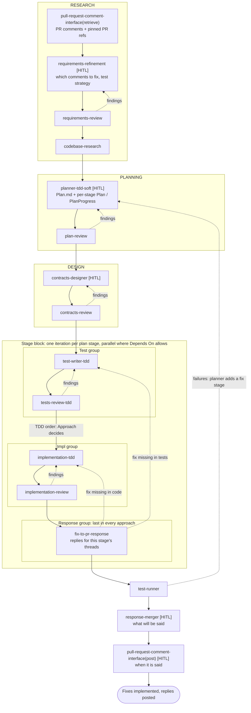

<Workflow type="core" name="brownfield-pr-fix" version="1.3">
## Brownfield PR Fix Workflow

**Use when:** Resolving PR review comments on an **existing codebase** — fetch active comments, refine scope and test strategy with user, research context, plan, design contracts and implement fixes, generate resolution replies per stage, merge, and post back to the PR.

| Phase | Subagent | HITL | On Success | On Findings | Input | Output |
|-------|----------|:----:|------------|-------------|-------|--------|
| RESEARCH | pull-request-comment-interface(retrieve) | FALSE | requirements-refinement | - | Requirements.md | PullRequestComments.md, PullRequestResponses.md, PullRequestContext.md |
| RESEARCH | requirements-refinement | TRUE | requirements-review | - | Requirements.md, PullRequestComments.md | Requirements.md |
| RESEARCH | requirements-review | FALSE | codebase-research | requirements-refinement | Requirements.md | requirements-review.md |
| RESEARCH | codebase-research | FALSE | planner-tdd-soft | - | Requirements.md, PullRequestComments.md, PullRequestContext.md | Research.md |
| PLANNING | planner-tdd-soft | TRUE | plan-review | - | Research.md, Requirements.md, PullRequestComments.md, PullRequestContext.md | Plan.md, Stage-*/Plan.md, Stage-*/PlanProgress.md |
| PLANNING | plan-review | FALSE | contracts-designer | planner-tdd-soft | Requirements.md, PullRequestComments.md, PullRequestContext.md, Plan.md, Stage-*/Plan.md | plan-review.md |
| DESIGN | contracts-designer | TRUE | contracts-review | - | Research.md, Requirements.md, PullRequestComments.md, PullRequestContext.md, Plan.md, Stage-*/Plan.md | ContractsDesign.md |
| DESIGN | contracts-review | FALSE | [Stage] | contracts-designer | PullRequestContext.md, Plan.md, Stage-*/Plan.md, ContractsDesign.md | contracts-review.md |
| EXECUTION.[Stage].Test | test-writer-tdd | FALSE | tests-review-tdd | - | PullRequestContext.md, Stage-{Stage}/Plan.md, ContractsDesign.md, Stage-{Stage}/PlanProgress.md | Stage-{Stage}/PlanProgress.md |
| EXECUTION.[Stage].Test | tests-review-tdd | FALSE | COMPLETE | test-writer-tdd | PullRequestContext.md, Stage-{Stage}/Plan.md, ContractsDesign.md, Stage-{Stage}/PlanProgress.md | Stage-{Stage}/tests-review-tdd.md |
| EXECUTION.[Stage].Impl | implementation-tdd | FALSE | implementation-review | - | PullRequestContext.md, Stage-{Stage}/Plan.md, ContractsDesign.md, Stage-{Stage}/PlanProgress.md | Stage-{Stage}/PlanProgress.md |
| EXECUTION.[Stage].Impl | implementation-review | FALSE | COMPLETE | implementation-tdd | PullRequestContext.md, Stage-{Stage}/Plan.md, ContractsDesign.md, Stage-{Stage}/PlanProgress.md | Stage-{Stage}/implementation-review.md |
| EXECUTION.[Stage].Response | fix-to-pr-response | FALSE | COMPLETE | - | PullRequestContext.md, Stage-{Stage}/Plan.md, Stage-{Stage}/PlanProgress.md, PullRequestComments.md, PullRequestResponses.md | Stage-{Stage}/PullRequestResponses.md |
| REVIEW | test-runner | FALSE | response-merger | planner-tdd-soft | Requirements.md, Plan.md | TestResults.md |
| REVIEW | response-merger | TRUE | pull-request-comment-interface(post) | - | PullRequestComments.md, Stage-*/PullRequestResponses.md | PullRequestResponses.md |
| COMPLETION | pull-request-comment-interface(post) | TRUE | COMPLETE | - | PullRequestResponses.md | PullRequestResponses.md |

**Blocks:**

| Block | Source | Section |
|-------|--------|---------|
| Stage | Plan.md | Stages |

**Groups:**

| Block | Approach | Groups |
|-------|----------|--------|
| Stage | TDD | Test, Impl, Response |
| Stage | Implementation-First | Impl, Test, Response |
| Stage | Implementation-Only | Impl, Response |
| Stage | Tests-Only | Test, Response |

**Notes:**
- Requirements.md is written by the user: the PR ID, optionally minimal scope hints.
</Workflow>

---

## Flow

Solid arrows: the happy path (`On Success`). Dotted arrows: where findings usually go (`On Findings`). `[HITL]`: a human stop. Each stage runs the groups its `Approach` lists, in that order: `TDD` = Test, Impl, Response (drawn here), `Implementation-First` = Impl, Test, Response, `Implementation-Only` / `Tests-Only` = one work group, then Response. `fix-to-pr-response` has no declared fix target: when a fix is missing, the orchestrator sends it to the code or the tests according to its status message.

---

## Design Rationale

The inverse of `brownfield-pr-audit`: where that workflow reads code and produces PR comments, this one reads PR comments and fixes code, then replies to say what was fixed.

Requirements-refinement was added because PR comments are not inherently actionable requirements — they vary from nitpicks to architectural rethinks to questions that aren't fix requests at all. The user needs a gate to triage which comments become work items and to set the test strategy (regression tests for everything, complex fixes only, or none). Without this, the planner would treat every unresolved comment as an equal-priority fix request and guess at the test approach. Requirements-review follows because the enriched Requirements.md is the document the entire downstream chain depends on — if refinement produced something ambiguous or contradictory, better to catch it before planning than after.

**Refinement runs before research, unlike brownfield-tdd, on purpose.** Here the seed Requirements.md holds only the PR ID, so there is nothing to research yet: refinement first decides with the user which comments are fixed, and codebase-research then researches only those. For the same reason refinement has no `On Findings` route to research: research's next step is the planner, so a route back would plan on requirements that still hold open questions. Those go to the orchestrator.

**The design phase matches brownfield-tdd.** A PR fix is the same work as a brownfield change; only the source of what to do differs (PR comments rather than user requirements). Without contracts, execution agents decided interfaces on their own and performed worse. It always runs: when no interface or data structure changes, contracts-designer writes a short "no contract changes" design, which is a cheap extra dispatch. The designer also reads `PullRequestComments.md`, because comments are the source of what to fix and may ask for interface changes, and `PullRequestContext.md`, so it can tell code the PR introduced from code that was there before. The Response row does not read the design: it matches code changes to comments, which needs no contracts.

The core design tension was where to generate resolution comments — once after all stages (simpler, one agent) or per-stage with a merger (more complex, two agents). Per-stage won because: (1) resolution comments should be grounded in actual code changes, not plan progress summaries; (2) a post-hoc agent reading all stages at once doesn't scale to large PRs; (3) per-stage generation keeps context fresh — the agent sees the diff while it's small and specific. The per-stage reply step is its own group, `Response`, listed last in every approach. A `Tests-Only` stage writes replies too: PR comments can be about the tests themselves.

**PR scope is pinned in `PullRequestContext.md`.** The retrieve row records the target and source branches, the PR head and the merge-base as commits, resolved once and unchanged for the run. Without a fixed base, an agent compares against `HEAD`, which contains the PR's own changes, and reports code the PR introduced as pre-existing. It is a separate artifact because the rows that judge scope should not load the whole comment history. It holds refs and a one-line statement of purpose only — no title, description or thread data — so a global input cannot anchor a stage agent or widen its task beyond its stage plan. Requirements.md carries only the PR ID: the platform supplies the rest, and the retrieve row returns `NEEDS_CLARIFICATION` if it cannot.

**A reply can send work back.** When a stage plan names a thread and the work it asks for was not done, `fix-to-pr-response` returns `COMPLETED_NEEDS_ACTION`, and its status message says whether the code or the tests are missing the fix. Its `On Findings` stays `-` on purpose: the right target depends on the stage, one cell can name only one, and the format allows no target in another group. The orchestrator routes from the status message. The stage plan is the agent's only source of what the stage owes: a thread the plan does not name may belong to a later stage, so it never counts as a finding.

The planner does not need special instructions to reference PR comment thread IDs in stage plans. `fix-to-pr-response` handles the comment-to-fix mapping independently using file/line proximity from git diffs plus semantic matching against the original comment content. Thread references in a plan (it reads PullRequestComments.md as input, and in a real run named every active thread) are what make a finding possible; without them the agent still writes replies but raises no findings, so a plan without references loses detection, not accuracy.

test-runner findings route to the planner, not to implementation-tdd. This was a lesson learned from brownfield-tdd v3.7: test failures after all stages complete may indicate plan-level issues (missed dependencies, incorrect sequencing, insufficient test coverage decisions) that only the planner can resolve by restructuring stages. It is also the only fix target the format allows there: test-runner runs after the Stage block has exited, completed stages are frozen, and the planner adds a fix stage that runs when the block is entered again.

**test-runner runs the whole suite.** It is the regression check for impacts nobody planned, so its inputs never narrow the scope. `Requirements.md` is where the user accepts known failures for this run; `Plan.md` is only orientation on what the run built. Stage plans are left out: matching a failure to a stage is the planner's job, and it has the best context for it. Every failure that is not accepted is a finding, including ones that may have failed before the run. test-runner does not check out earlier code to tell them apart: switching code versions mid-run risks the run's own work, and the planner can decline a finding that is out of scope.

Each reviewer's suggested fix target is its own creator. Deeper routing — implementation-review findings that trace back to the plan or to missing research — is the orchestrator's decision under its routing policy, not a declared route.

Two HITL gates at the end serve different purposes: response-merger HITL lets the user review what will be said (content), pull-request-comment-interface(post) HITL lets the user control when it's said (timing synchronization with their own code push).

---

## Changelog

| Version | Date | Author | Summary |
|---------|------|--------|---------|
| 0.1 | 2026-08-20 | MOSAIC | Initial version |
| 0.2 | 2026-08-26 | MOSAIC | Replace Unicode emoji with ASCII tokens in HITL column (TRUE/FALSE). |
| 0.3 | 2026-10-02 | MOSAIC | Provide the canonical PullRequestResponses.md schema artifact to each fix-to-pr-response stage and align frontmatter with the workflow region version. |
| 1.0 | 2026-10-10 | MOSAIC | Migrated to WorkflowFormat 2.16: `[StageNumber]` → declared block `[Stage]` (`**Blocks:**` table), Phase cells in `PHASE.[Block].Group` order, `**Groups:**` table with `Block` column. Routing made scope-correct: `plan-review` enters `[Stage]` (was the legacy `test-writer-tdd*`); every group's last row says `COMPLETE`, and the block's exit continues to `test-runner`. `artifacts` gains `Stage-*/PullRequestResponses.md`. Notes cut to the Requirements.md seed content; the rest were redundant with the tables or are executor policy (moved to Design Rationale). |
| 1.1 | 2026-11-01 | MOSAIC | `PullRequestContext.md` added: pinned PR refs, output by the retrieve row and read by research, planning, plan review and every Stage row. `Tests-Only` now runs the `Response` group. The Requirements.md seed needs only the PR ID. |
| 1.2 | 2026-11-22 | MOSAIC | test-runner reads `Requirements.md` and `Plan.md` (was `-`): under a generic task message it had no context and asked for its scope every run. |
| 1.3 | 2026-11-22 | MOSAIC | Design phase added, as in brownfield-tdd: `contracts-designer` (HITL) and `contracts-review` between plan review and the Stage block. Test and Impl rows read `ContractsDesign.md`; the Response row does not. |

---

## Open Ideas / Dead Ends

Capture ideas that were explored but not adopted, and future improvements worth considering. This prevents the same dead ends from being revisited unknowingly.

**Ideas under consideration:**
- **Reuse audit-response-merger instead of new response-merger.** audit-response-merger has the right mechanical pattern (script-driven merge of partial response queues) but is audit-specific — expects TransformReport files, uses file+line overlap dedup for audit findings. The fix-response merge is simpler (thread-ID dedup). If the two mergers converge over time, consider generalizing into one.

**Dead ends (tried and rejected):**
- **Research before refinement, as in brownfield-tdd.** Research would cover every open comment, including the ones the user drops from scope, and the seed holds nothing to research beyond the PR ID.
- **Single post-hoc response agent (Option B).** Reading all Stage-*/PlanProgress.md after execution to generate replies in one pass. Rejected: plan progress is too summarized — agents may diverge from the plan for good reasons, and resolution comments need to reflect actual code changes, not checkbox summaries. Also doesn't scale to large PRs.
- **Planner injection for comment thread references.** Considered requiring the planner to include PR comment thread IDs in stage plans via a deploy-time injection. Rejected: the injection only makes sense for this workflow (not a project convention), and `fix-to-pr-response` can independently match fixes to comments via file/line proximity, making the planner dependency unnecessary.
- **PR refs only in the `pr_context` header.** Rejected: Stage rows do not read the comment artifacts, and loading them there would bring the whole comment history into every stage.
- **Planner copying PR refs into stage plans.** Rejected: a generic planner has no instruction to do it, and in a real run a stage that needed the refs did not get them.
- **PR description in PR context.** Rejected: agents read it as intent and it can go stale. Anything that matters belongs in Requirements.md.
- **`fix-to-pr-response` at the end of the Impl group.** It would allow `On Findings: implementation-tdd`, but `Tests-Only` stages also need replies and their fixes go to the tests.
- **One response row per group.** `TDD` and `Implementation-First` stages would reply twice.
