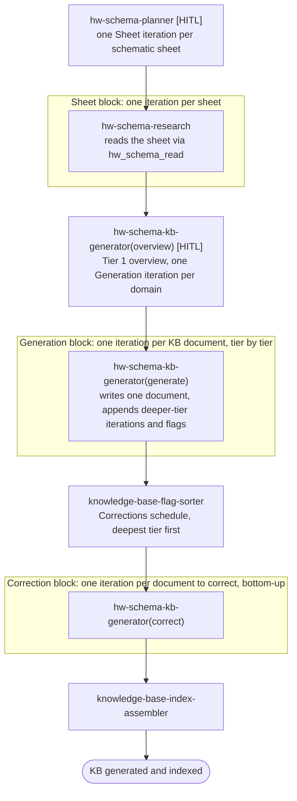

<Workflow type="core" name="hw-schema-kb-generation" version="1.1">
## HW Schema Knowledge Base Generation Workflow (Sequential)

**Use when:** Generate knowledge base documentation for a **hardware schematic design**. Researches each sheet individually, then synthesizes domain-oriented KB documentation with tiered abstraction — from project overview down to complex circuit subsystems. Iterations run one at a time, never in parallel.

| Phase | Subagent | HITL | On Success | On Findings | Input | Output |
|-------|----------|:----:|------------|-------------|-------|--------|
| PLANNING | hw-schema-planner | TRUE | [Sheet] | - | Requirements.md | HWResearchProgress.md |
| RESEARCH.[Sheet] | hw-schema-research | FALSE | COMPLETE | - | Requirements.md, HWResearchProgress.md | HWResearchProgress.md |
| EXECUTION | hw-schema-kb-generator(overview) | TRUE | [Generation] | - | Requirements.md, HWResearchProgress.md | KBProgress.md |
| EXECUTION.[Generation] | hw-schema-kb-generator(generate) | FALSE | COMPLETE | - | Requirements.md, HWResearchProgress.md, KBProgress.md | KBProgress.md, KBFlags.md |
| REVIEW | knowledge-base-flag-sorter | FALSE | [Correction] | - | KBProgress.md, KBFlags.md | KBFlagReport.md, KBProgress.md |
| REVIEW.[Correction] | hw-schema-kb-generator(correct) | FALSE | COMPLETE | - | KBProgress.md, KBFlagReport.md | KBProgress.md |
| COMPLETION | knowledge-base-index-assembler | FALSE | COMPLETE | - | KBProgress.md | KBProgress.md |

**Blocks:**

| Block | Source | Section |
|-------|--------|---------|
| Sheet | HWResearchProgress.md | Stages |
| Generation | KBProgress.md | Generation |
| Correction | KBProgress.md | Corrections |

**Notes:**
- Run the iterations of every block one at a time, never in parallel, even when the user asks for parallel execution. Sheet and Generation iterations edit the shared HWResearchProgress.md, KBProgress.md and KBFlags.md, and concurrent edits overwrite each other. Tell the user this workflow does not support parallel execution and continue sequentially.
</Workflow>

---

## Flow

Solid arrows: the happy path (`On Success`). `[HITL]`: a human stop. Every block runs its iterations one at a time. No fix targets: inaccuracies travel as flags and are fixed in the Correction block.

---

## Design Rationale

Tested a handful of times with output manually verified and the workflow polished as a result — not yet production-proven, but past the purely theoretical stage.

**This workflow has an unusually explicit external dependency, worth calling out at the workflow level rather than leaving it buried in an agent's tool list.** The research stage requires the ability to actually read hardware schematic sheets, which happens through a dedicated tool the research agent depends on. Unlike the file/terminal tools every other workflow in the catalog assumes are simply available, this one is not generic — it has to be provided by whoever deploys the workflow, wired to their specific schematic format and tooling. Every other workflow in the catalog gets by on generic file/terminal access; this is the one case where the workflow cannot run at all without a project-specific tool being present first. Users select workflows, not agents, so this dependency needs to be visible here, not only inside the research agent's own instructions.

**Seed.** `Requirements.md` is user-written and must name the schematic project path and the KB output path; focus areas are optional.

**Three blocks, three schedules.**
- **Sheet** — the planner writes one row per sheet into `HWResearchProgress.md`. Sheets have no dependencies on each other, but their iterations still run one at a time (see Sequential only). Each sheet's findings go to a project file (e.g. `SheetsResearch/Sheet-03.md`), not an orchestration artifact; its path is recorded in `HWResearchProgress.md`, which is how the KB generator finds it. These files are temporary and can be removed after the run.
- **Generation** — the Tier 1 overview runs once, outside any block (`hw-schema-kb-generator(overview)`), because it is what discovers the functional domains: it reads every sheet's research and creates `KBProgress.md` with one Generation row per domain. Generation iterations may append deeper-tier rows as they discover topics that need them (WorkflowFormat §9.3), so the block keeps running until none is left. The overview row is human-gated; the Generation row is not, and per-domain review is switched on through the schedule's `HITL` column.
- **Correction** — the flag sorter turns accumulated flags into one correction row per target document, ordered bottom-up by tier and chained through `Depends On`, so deeper documents are corrected before their parents.

Two progress artifacts are kept apart on purpose: `HWResearchProgress.md` tracks per-sheet research, `KBProgress.md` tracks KB generation and correction — different concerns with different lifecycles.

**No fix targets.** None of the rows is a reviewer; inaccuracies found during generation travel as correction flags and are handled by the Correction block, not by routing.

**Sequential only.** Sheet iterations edit the shared `HWResearchProgress.md`; Generation iterations edit the shared `KBProgress.md` (their own `Status`, and appended deeper-tier rows) and `KBFlags.md` (appended flags). Some harnesses let an agent write a file whose content changed since it last read it, so parallel iterations overwrite each other: progress entries and flags disappear, appended rows disappear — a lost row is a deeper document that silently never gets written — and two siblings appending at once mint the same next ID. The format offers no safe way for parallel iterations to grow one schedule, so the workflow runs every iteration one at a time, the same decision as `kb-generation`. The ban is a note, which binds the LLM orchestrator — the only executor that runs iterations in parallel.

**Runner.** Block agents find their work by the iteration ID stated in the task. The Runner's auto modes send a generic task without it, and no Input or Output path carries it, so the Runner cannot run this workflow.

---

## Changelog

| Version | Date | Author | Summary |
|---------|------|--------|---------|
| 0.5 | 2026-08-17 | MOSAIC | Changelog tracking begins here; earlier revisions predate this record. |
| 0.6 | 2026-08-26 | MOSAIC | Replace Unicode emoji with ASCII tokens in HITL column (TRUE/FALSE). |
| 1.0 | 2026-10-10 | MOSAIC | Migrated to WorkflowFormat 2.16. `[StageNumber]` replaced by three declared blocks — `Sheet` (`HWResearchProgress.md` § Stages), `Generation` (`KBProgress.md` § Generation) and `Correction` (`KBProgress.md` § Corrections). `Waits For` barriers (`hw-schema-research*`, legacy suffix) dropped: block exit is the barrier, so the column is gone. The first KB generator run is now its own row, `hw-schema-kb-generator(overview)`, outside the Generation block, since a block's schedule must exist before the block is entered; it carries the human gate, and the Generation row is `FALSE` with per-domain HITL from the schedule. Routing scope-correct: rows enter blocks with `[Name]`, block rows end their iteration with `COMPLETE`. Notes removed — redundant with the tables or moved to Design Rationale. |
| 1.1 | 2026-11-22 | MOSAIC | Declared sequential-only: a note forbids running block iterations in parallel (shared HWResearchProgress.md, KBProgress.md and KBFlags.md writes overwrite each other on some harnesses); name, description, hint and **Use when:** say so. Hint also states that the Runner's auto modes cannot run it (no iteration ID in a generic task). Tables unchanged. |

---

## Open Ideas / Dead Ends

Capture ideas that were explored but not adopted, and future improvements worth considering. This prevents the same dead ends from being revisited unknowingly.

**Ideas under consideration:**
- **Branched generation** — the overview row already discovers the domains; each domain could be a branch with its own schedule and flags artifacts and dynamic tiers inside it (nested block), running branches in parallel. See `kb-generation-branched`, the codebase experiment; port it here once that proves out.
- **Binding sequential order, Runner iteration ID, fragment-assembled schedules** — the same ideas recorded in `kb-generation`.

**Dead ends (tried and rejected):**
- (none yet)
