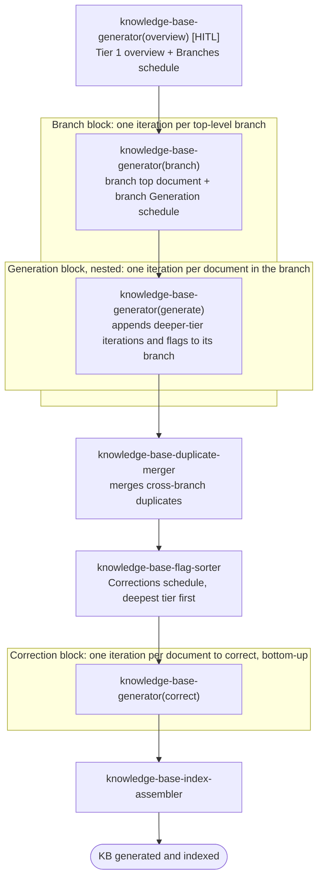

<Workflow type="core" name="kb-generation-branched" version="0.2">
## Knowledge Base Generation Workflow (Branched, Experimental)

**Use when:** Experimental: generate a new N-tier knowledge base for a codebase. Top-level branches are generated in parallel, each growing its own dynamic tiers; documents within a branch are generated one at a time, and cross-branch duplicates are merged afterwards.

| Phase | Subagent | HITL | On Success | On Findings | Input | Output |
|-------|----------|:----:|------------|-------------|-------|--------|
| PLANNING | knowledge-base-generator(overview) | TRUE | [Branch] | - | Requirements.md | KBProgress.md |
| EXECUTION.[Branch] | knowledge-base-generator(branch) | FALSE | [Generation] | - | Requirements.md, KBProgress.md | Branch-{Branch}/KBProgress.md, Branch-{Branch}/KBFlags.md |
| EXECUTION.[Branch].[Generation] | knowledge-base-generator(generate) | FALSE | COMPLETE | - | Requirements.md, KBProgress.md, Branch-{Branch}/KBProgress.md | Branch-{Branch}/KBProgress.md, Branch-{Branch}/KBFlags.md |
| REVIEW | knowledge-base-duplicate-merger | FALSE | knowledge-base-flag-sorter | - | KBProgress.md, Branch-*/KBProgress.md, Branch-*/KBFlags.md | Branch-*/KBProgress.md, Branch-*/KBFlags.md, KBMergeReport.md |
| REVIEW | knowledge-base-flag-sorter | FALSE | [Correction] | - | KBProgress.md, Branch-*/KBProgress.md, Branch-*/KBFlags.md | KBFlagReport.md, KBProgress.md |
| REVIEW.[Correction] | knowledge-base-generator(correct) | FALSE | COMPLETE | - | KBProgress.md, KBFlagReport.md | KBProgress.md, KBFlagReport.md |
| COMPLETION | knowledge-base-index-assembler | FALSE | COMPLETE | - | KBProgress.md, Branch-*/KBProgress.md | KBProgress.md |

**Blocks:**

| Block | Source | Section |
|-------|--------|---------|
| Branch | KBProgress.md | Branches |
| Generation | Branch-{Branch}/KBProgress.md | Generation |
| Correction | KBProgress.md | Corrections |

**Notes:**
- Branch iterations may run in parallel. Run the Generation iterations of one branch one at a time, never in parallel, even when the user asks for it: they edit their branch's shared KBProgress.md and KBFlags.md, and concurrent edits overwrite each other.
</Workflow>

---

## Flow

Solid arrows: the happy path (`On Success`). `[HITL]`: a human stop. Branches run in parallel; Generation iterations within a branch, and Correction iterations, run one at a time. No fix targets: inaccuracies travel as flags and are fixed in the Correction block.

---

## Design Rationale

**Experiment.** This workflow tests whether `kb-generation` can run in parallel without losing dynamic tier depth, its key strength. `kb-generation` is sequential-only because every generation iteration writes one shared schedule and one shared flags file, and some harnesses let parallel writers overwrite each other. Here the unit of parallel work is a top-level branch, and each branch owns its own schedule and flags artifacts, so parallel iterations never write the same file.

**Seed and scope.** `Requirements.md` is user-written: the generation scope, optional focus areas, and optionally the KB output path. The workflow builds a new KB only; re-running `kb-generation` refreshes an existing one.

**Shape.**
- **Overview.** `(overview)` writes the Tier 1 project overview and the `## Branches` schedule in the run-root `KBProgress.md`, one row per top-level branch. It is the one human gate: the user reviews the branch split before any branch work starts. Obvious cross-cutting concerns should become branches of their own, which reduces the duplicates the merge step has to handle.
- **Branch.** Per branch, `(branch)` writes the branch's top document and creates `Branch-{Branch}/KBProgress.md` with that branch's initial `## Generation` schedule, possibly empty. The row exists because a block schedule must exist before its block is entered (A7).
- **Generation.** The nested block runs over the branch's own schedule. Iterations write documents, append deeper-tier rows to their branch's schedule and flags to their branch's flags file, as in `kb-generation`, but only within their branch. Tiers stay dynamic per branch.
- **Duplicate merge.** Once every branch has finished, the merger compares the branches, consolidates documents that cover the same topic, and edits the branch progress artifacts and flags in place so they point at the surviving documents. It runs before the flag sorter so that corrections apply to merged documents, and the downstream agents need no knowledge of merges. `KBMergeReport.md` records every merge — it is also the experiment's measurement of how often branches overlap.
- **Flags and corrections.** The flag sorter reads every branch's schedule and flags and writes the single `## Corrections` schedule in the run-root `KBProgress.md`. Corrections run bottom-up, one at a time, as in `kb-generation`, including recording correction work discovered during the pass as flags in `KBFlagReport.md`. The index assembler reads every progress artifact.

**Why parallel is safe here.** The run-root `KBProgress.md` is written only by rows that never run concurrently: overview, flag sorter, the chained correction iterations, and the assembler. Branch artifacts are written only by that branch's rows, which run one at a time, and later by the merger, which runs alone. The branch artifacts fill in only `{Branch}`, so the Generation iterations of one branch share them on purpose (A14, A16 allow it) — which is why the note keeps those iterations sequential.

**Why a dedicated merger.** Emitting merge flags for the correction pass was considered: a correction row handles one target document, while a merge touches two documents, the progress tables and parent-document references. The merger sits outside every block because it must see all branches, which no iteration may (A14).

**Known risks.**
- **Branch perspectives.** Two branches may describe one mechanism from different angles. The merger must keep both angles in the surviving document and leave a pointer from each branch's parent document, not discard one copy.
- **Unbalanced branches.** Run time is roughly that of the longest branch.

**HITL.** One gate, at the overview. The merger is `FALSE`; its report allows a review after the run.

**Runner.** The Runner does not run nested blocks, so it cannot run this workflow.

**Agent dependencies.** The workflow needs `knowledge-base-generator` 4.1.0+ (`overview` and `branch` modes, `generate` in a branch, discovered corrections recorded as flags), `knowledge-base-flag-sorter` 3.5.0+ (keeps those flags on re-invocation) and `knowledge-base-index-assembler` 2.3.0+ (several progress and flags artifacts), and `knowledge-base-duplicate-merger`. Contract points between them: flags in branch work carry a `Source Branch` field; the run-root `## Configuration` names the Tier 1 overview document and `## Branches` carries each branch's top document with its tier; a branch does not schedule a topic that is another branch's scope, which cuts duplicates before the merger runs; the merger never removes the overview or a branch's top document, deletes the removed copies only as the last step of each merge, and aligns a repointed row's `Tier` with the kept document.

---

## Changelog

| Version | Date | Author | Summary |
|---------|------|--------|---------|
| 0.1 | 2026-11-22 | MOSAIC | Experimental initial version: branch-parallel variant of `kb-generation` with per-branch schedules and flags in a nested block, and a cross-branch duplicate merge before flag sorting. |
| 0.2 | 2026-11-22 | MOSAIC | `knowledge-base-generator(correct)` also outputs KBFlagReport.md: correction work discovered during the correction pass is recorded there as a flag, so the iteration that runs it knows what to correct. |

---

## Open Ideas / Dead Ends

**Ideas under consideration:**
- **Port to `hw-schema-kb-generation`** — its overview row already discovers domains; port once this experiment proves out.

**Dead ends (tried and rejected):**
- See `kb-generation` — per-iteration flag files only, and fixed tier blocks with merge rows.
