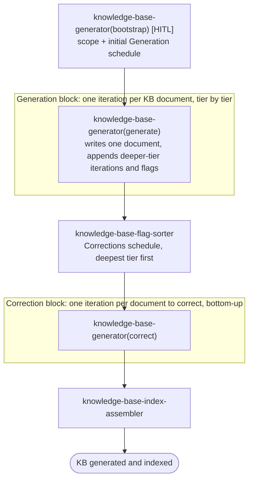

<Workflow type="core" name="kb-generation" version="2.2">
## Knowledge Base Generation Workflow (Sequential)

**Use when:** Generate N-tier knowledge base documentation for a codebase. Produces hierarchical documentation optimized for AI agent navigation — tiered from project overview down to complex subsystem specs. Iterations run one at a time, never in parallel.

| Phase | Subagent | HITL | On Success | On Findings | Input | Output |
|-------|----------|:----:|------------|-------------|-------|--------|
| PLANNING | knowledge-base-generator(bootstrap) | TRUE | [Generation] | - | Requirements.md | KBProgress.md |
| EXECUTION.[Generation] | knowledge-base-generator(generate) | FALSE | COMPLETE | - | Requirements.md, KBProgress.md | KBProgress.md, KBFlags.md |
| REVIEW | knowledge-base-flag-sorter | FALSE | [Correction] | - | KBProgress.md, KBFlags.md | KBFlagReport.md, KBProgress.md |
| REVIEW.[Correction] | knowledge-base-generator(correct) | FALSE | COMPLETE | - | KBProgress.md, KBFlagReport.md | KBProgress.md, KBFlagReport.md |
| COMPLETION | knowledge-base-index-assembler | FALSE | COMPLETE | - | KBProgress.md | KBProgress.md |

**Blocks:**

| Block | Source | Section |
|-------|--------|---------|
| Generation | KBProgress.md | Generation |
| Correction | KBProgress.md | Corrections |

**Notes:**
- Run the iterations of every block one at a time, never in parallel, even when the user asks for parallel execution. Generation iterations edit the shared KBProgress.md and KBFlags.md, and concurrent edits overwrite each other. Tell the user this workflow does not support parallel execution and continue sequentially.
</Workflow>

---

## Flow

Solid arrows: the happy path (`On Success`). `[HITL]`: a human stop. Every block runs its iterations one at a time. No fix targets: inaccuracies travel as flags and are fixed in the Correction block.

---

## Design Rationale

Excellent, recommended workflow — run this first on a codebase before starting any other workflow against it. The research-phase agents used across the Build/Audit/Design workflows actively look for an existing KB when they run, and their performance improves noticeably when one is present.

The KB's tiered structure is deliberately kept abstract — general subsystem descriptions rather than concrete file, class, or method names — which trades a little specificity for resistance to going stale as the codebase changes underneath it. This pays off in practice: planning agents elsewhere in the catalog can often fold documentation updates for a change directly into a normal feature plan without much quality loss, precisely because the abstraction level means most code-level changes don't invalidate what the KB actually says. That means a refresh run is not required after every change — it's there for drift that accumulates past what in-line plan updates catch, not as a mandatory step in every feature's lifecycle.

**Seed.** `Requirements.md` is user-written: the generation scope, optional focus areas, and optionally the KB output path. Re-running the workflow on an existing KB refreshes it after codebase changes — the generator updates existing documents and flags new drift.

**Two blocks over one progress artifact.** `KBProgress.md` holds two block schedules: `## Generation` (one iteration per KB document to write) and `## Corrections` (one iteration per KB document to correct). The generator appears in three rows, told apart by mode: `(bootstrap)` creates `KBProgress.md` with the initial Generation iteration(s) before the block is entered — a block schedule must exist before its block runs — then `(generate)` writes one document per iteration, and `(correct)` applies the sorted flags to one document per iteration.

**Dynamic, tier-sequential generation.** Each generation iteration may append deeper-tier iterations to the Generation schedule as it discovers areas that need them; their `Depends On` makes each tier wait for the tier above, so tiers run one after another. Within a tier, iterations also run one at a time (see Sequential only). The block exits only once every iteration — including the ones added during the run — has completed, so the flag sorter sees every flag.

**Bottom-up corrections.** The flag sorter writes the Corrections schedule ordered deepest tier first, each correction depending on the one before, so corrections run one at a time: a higher-tier document is corrected only after the lower-tier documents it summarises are accurate. With no flags, the Corrections schedule is empty and the block exits at once. A correction that reveals further correction work writes it as a flag into KBFlagReport.md, under the target document's section, and schedules a Correction row only when no pending row already covers that document. The later iteration finds the reason where every correction looks for it. This shared write is safe because correction iterations run one at a time.

**HITL.** One human gate, at the start: the `bootstrap` row is `TRUE`, so the user reviews the initial Generation schedule — scope and Tier 1 plan — before any documentation is written. Every following row is `FALSE`, and the generator writes every schedule row with `HITL` `FALSE`, keeping the rest of the run frictionless. Per-iteration review stays available through the `HITL` column of the Generation schedule — set it to `TRUE` during the bootstrap review for the iterations you want to see.

**Sequential only.** Every generation iteration writes two shared run artifacts: `KBProgress.md` (its own `Status`, and appended deeper-tier rows) and `KBFlags.md` (appended flags). Some harnesses let an agent write a file whose content changed since it last read it, so parallel iterations overwrite each other: flags disappear, appended rows disappear — a lost row is a deeper document that silently never gets written — and two siblings appending at once mint the same next ID. A shared schedule is also what lets a generator see that a sibling already scheduled a topic, so the same topic is not planned twice; that only works when the writes do not race. The format offers no safe way for parallel iterations to grow one schedule (only block rows may grow it, iterations cannot read each other's artifacts, and the table cannot loop), so the workflow runs every iteration one at a time. The ban is a note, which binds the LLM orchestrator — the only executor that runs iterations in parallel. The parallel-capable experiment is `kb-generation-branched`.

**Runner.** The `generate` and `correct` rows find their work by the iteration ID stated in the task. The Runner's auto modes send a generic task without it, and no Input or Output path carries it, so the Runner cannot run this workflow.

---

## Changelog

| Version | Date | Author | Summary |
|---------|------|--------|---------|
| 1.0 | 2026-08-17 | MOSAIC | Changelog tracking begins here; earlier revisions predate this record. |
| 1.1 | 2026-08-26 | MOSAIC | Replace Unicode emoji with ASCII tokens in HITL column (TRUE/FALSE). |
| 1.2 | 2026-09-10 | MOSAIC | Set HITL to FALSE by default for frictionless first-run experience. Per-stage HITL still configurable in KBProgress.md. |
| 2.0 | 2026-10-10 | MOSAIC | Migrated to WorkflowFormat 2.16. `[StageNumber]` split into two declared blocks over `KBProgress.md` — `[Generation]` (section `Generation`) and `[Correction]` (section `Corrections`). New `knowledge-base-generator(bootstrap)` row creates the Generation schedule before the block (A7); the first generation iteration no longer bootstraps it. `Waits For` column removed — the flag sorter follows the Generation block's exit, so no join is needed (T13); legacy `*` suffix gone. Block rows end their iteration with `COMPLETE`. Tier-sequential and bottom-up ordering now come from `Depends On` in the schedules. The `bootstrap` row is the one human gate (`TRUE`); all following rows are `FALSE`. Notes removed — redundant with the tables or moved to Design Rationale. |
| 2.1 | 2026-11-22 | MOSAIC | Declared sequential-only: a note forbids running block iterations in parallel (shared KBProgress.md and KBFlags.md writes overwrite each other on some harnesses); name, description, hint and **Use when:** say so. Hint also states that the Runner's auto modes cannot run it (no iteration ID in a generic task). Tables unchanged. |
| 2.2 | 2026-11-22 | MOSAIC | `knowledge-base-generator(correct)` also outputs KBFlagReport.md: correction work discovered during the correction pass is recorded there as a flag, so the iteration that runs it knows what to correct (previously an appended Correction row carried only the target path, and the discovered problem was lost). |

---

## Open Ideas / Dead Ends

Capture ideas that were explored but not adopted, and future improvements worth considering. This prevents the same dead ends from being revisited unknowingly.

**Ideas under consideration:**
- **Branched generation** — one block iteration per top-level branch, each with its own schedule and flags artifacts, tiers dynamic inside a branch (nested block). Branches run in parallel, documents within a branch sequentially. Built as the experimental `kb-generation-branched`.
- **Binding sequential order** — the generator writes each new Generation row with `Depends On` naming the row above (as the Corrections schedule already does), so every executor runs iterations in order from the schedule alone instead of relying on the note. Needs a generator change.
- **Iteration ID in the Runner's generic task** — the native orchestrator names the iteration in its task; the Runner's auto modes do not. Adding it would let agents that read their own schedule row run under the Runner. A Runner change, useful beyond this workflow.
- **Schedule assembled from fragments** — a format change letting a block schedule be the union of per-iteration fragment files, so parallel iterations grow a schedule without shared writes. Keeps unlimited depth, but needs ordering and `Depends On` rules across fragments, and executor support.

**Dead ends (tried and rejected):**
- **Per-iteration flag files only** — removes the flag race but leaves the shared schedule writes (lost rows, duplicate IDs).
- **Fixed tier blocks with a merge row between tiers** — one block per tier, a single row merging each tier's recommendations into the next tier's schedule. Race-free and Runner-compatible, but caps the number of tiers; dynamic depth is this workflow's key strength.
