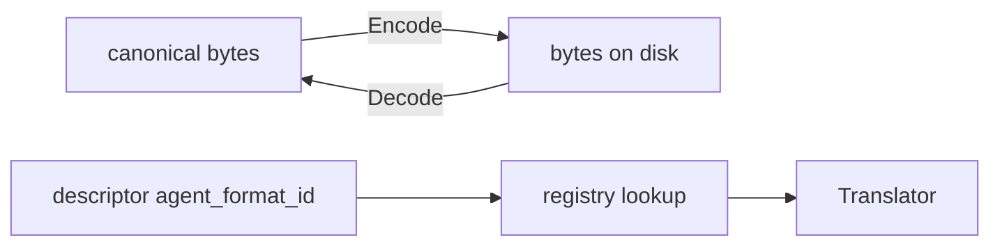

# Agent Format

> Part of: mosaic-deploy
> Responsibility: Let every harness keep its agent files in its own on-disk format (Markdown, Codex TOML, or any further format) while the rest of the tool works on one canonical form, and define what Deploy owns in a deployed agent and how a hand edit of it is detected.

## Overview

MOSAIC agent sources are Markdown with YAML frontmatter. A harness may store its deployed
agents in another format. Codex stores standalone TOML files. The agent-format layer
(`internal/agentformat`) is the single place that knows the difference. Everything above it
(plan, transform, app, deploy) handles the canonical form: Markdown with YAML frontmatter.

The format of a harness is named by `agent_format_id` in its descriptor (absent means
Markdown; the values are the vocabulary in `internal/agentformat/formatid`). The agent file
extension is declared separately under `extensions.agent`. Skills and hooks are never
translated; only agent artifacts go through a translator.

## The translator contract (`internal/agentformat/registry.go`)

`Translator` is a symmetric pair of pure functions (no I/O, clock or randomness):

- `Encode(canonical, ctx) (bytes, Report, error)` turns a canonical document into the bytes
  written to disk.
- `Decode(deployed, ctx) (canonical, Report, error)` turns bytes read from disk into the
  canonical form.

The round trip `Decode(Encode(d))` equals the encode-side normalisation of `d` over
MOSAIC-owned keys, user-owned keys, the body and the stamps, compared at value level.

`ArtifactContext` carries `AgentKey` (the sole authority for the name a format emits),
`Kind`, `PriorDeployed` (raw prior bytes, nil on create), `RefreshMode` (suppresses
deploy-path normalisations for harness-only refresh) and `Op`.

`Operation` (`OpCreate`, `OpUpdate`, `OpUnspecified`) is the create-versus-update decision.
A format that needs the prior-bytes channel (Codex) raises `ErrUnspecifiedOperation` on
`OpUnspecified` or on `OpCreate` with prior bytes, and `ErrMissingPriorBytes` on `OpUpdate`
without them. The Markdown identity translator ignores `Op`.

`Report` lists content a translator did not carry through verbatim, in either direction
(`ReportEntry`: kind, key, detail, reason). A translator has no channel to the user; the caller
merges every report into the run. Failures are `*ArtifactError` (phase `encode`, `decode` or
`strip`).

`Traits` (`internal/agentformat/traits.go`, resolved by `TraitsOf(formatID)`) are the facts the
application layer may branch on; the zero value is Markdown. `StampsOutsideData` marks a format
that stores provenance stamps outside its data model (Codex: TOML comments), so a valid file may
lack them without being foreign. `ClosedVocabulary` marks a format that natively holds only its
own keys and carries every other frontmatter key in the carriage container; its native keys are
harness artefacts that a rebuild into another harness strips and reports.

The carriage container (`internal/agentformat/carriage.go`, `codextoml/carriage.go`) is how a
closed-vocabulary format keeps frontmatter keys it has no native place for, so that decode
returns them and nothing is silently lost.

Registration: `Register` (called from a translator package's `init`), `Lookup`,
`LookupString` (an empty id means Markdown) and `RegisteredIDs`. The wiring package
`internal/agentformat/all` blank-imports every production translator; `cmd/mosaic-deploy`
imports it. `TestVocabularyEqualsRegistry` (`internal/agentformat/registration_test.go`) keeps the
vocabulary and the registry equal.

## The read funnel (`internal/app/deployed_read.go`)

Every read of a deployed agent in `internal/app` goes through this file, the only place in the
application layer that calls a translator's `Decode`. It has three layers:

1. `decodeDeployedBytes`: bytes in hand, no filesystem, no plan item.
2. `readDeployedArtifact`: reads a file, then calls layer 1.
3. `readDeployedPlanItem`: knows plan items, derives the `Operation` from the plan action with
   `actionToOp` (the one definition of that mapping), calls layer 2.

Skills and hooks pass through undecoded (`Raw == Canonical`).

`DeployedRead` returns `Raw` (exact on-disk bytes, in the harness's format) and `Canonical`
(decoded) together, so a caller cannot obtain one and forget the other. Its outcomes are absent
(a create), unreadable (`ReadErr`), corrupt (`DecodeErr`) and ok (with the translator's decode
`Report`). The two error channels never both carry a failure. Every consumer must surface the
decode report: `mergeDecodeReport` and `decodeReportNotices` translate it into the run's
vocabulary, and `logProbeDecodeNotices` (`decode_notice_log.go`) logs the notices of probed
states.

The per-item bytes of a rewrite come from one rule, `deployedBytes.funnelReader`
(`deployed_bytes.go`): captured migration bytes first, then the item's read path, decoded through
the funnel. All four flows (Deploy, Deploy agents, Update, Update workflows) build their content
callback from it, and `canonicalReader` wraps it for read-only consumers.

**Read-site inventory and its guard.** The comment block "Read-site inventory" at the top of
`deployed_read.go` lists every file in `internal/app` that references a funnel identifier. The
funnel-inventory rule in `tools/importcheck/funnel_inventory.go` enforces it both ways: a
non-test file that references a funnel identifier must be listed, and a listed file must
reference one. When you add a site that reads deployed agent bytes, route it through the funnel
and add the file to that list.

## The prior-bytes channel (`transform.Request`)

`transform.Request` (`internal/transform/types.go`) carries three views of the deployed file:

- `Deployed`: the canonical (decoded) bytes. Project-class injection regions are lifted from it.
- `DeployedRaw`: the file exactly as on disk, in the harness's own format. It is the
  translator's private channel for user-owned content the canonical value model cannot carry
  (for Codex, user keys, header comments and carriage markers). It is nil on create.
- `Op`: create versus update, carried straight to `ArtifactContext.Op`. The app layer sets it
  from the plan action; `transform` never infers it from whether `Deployed` is nil.

For a Markdown harness `Deployed` and `DeployedRaw` are identical, so a call site that drops
`DeployedRaw` is invisible until a closed-vocabulary format runs. This is the reason the funnel
returns raw and canonical together and `funnelReader` always supplies both with the `Op`.
Harness-only refresh receives canonical bytes from the funnel and threads `DeployedRaw` the same
way.

## Boundary rules

All of these run in `go test ./...` (through `tools/importcheck`'s tests, notably
`module_boundary_test.go`), in addition to `go run ./tools/importcheck` and the Taskfile targets:

- The translator layer (`internal/agentformat` and sub-packages) is pure and imports no harness,
  app, transform, frontend or infrastructure package (`translator_imports_test.go`,
  `internal/agentformat/purity_test.go`). `internal/agentfields` is the one permitted vocabulary
  package.
- `internal/deploy` imports no `internal/agentformat` package, including `formatid`
  (`tools/importcheck/deploy_imports_test.go`). The executor is format-blind: it writes the bytes
  it is given and records the record the app layer computes. The guard covers imports only, not
  format ids written as string literals.
- Application code must not call `docformat.Parse` or `docformat.SplitFrontmatter` directly. Only
  `deployed_read.go` (the funnel) and `parse_generic_source.go` (generic MOSAIC sources) may
  (`call_boundary_test.go`).
- The read-site inventory rule above (`funnel_inventory_test.go`).
- `transform` stays pure (no I/O packages), and nothing imports built-in harnesses except through
  the registry (see the Deployment Pipeline page).

## Owned content and hand edits

**What Deploy owns.** For an agent, Deploy owns the body outside the project and custom regions,
computed from the canonical (decoded) form, never from the on-disk bytes. The frontmatter and the
project and custom regions belong to the user for every harness; there is no per-harness
classification of keys. For a skill file or a hook file, Deploy owns the whole file. Records are
`domain.OwnedContent` (`internal/domain/owned_content.go`), computed by `transform.OwnedContentOf`.

**Both sides use the same basis.** On the write side the executor stores the record of the bytes
just written, computed by `agentOwnedContentFor` (`deployed_owned_written.go`) from
`decodeDeployedBytes` of those exact bytes. On the probe side `attachOwnedContent`
(`deployed_owned.go`) computes the record of what is on disk now from its decoded form. Because
both decode the same way, a format difference never reads as an edit. `ContentHash` in the
manifest entry is separate and stays over the exact written bytes, with no normalisation.
Integration-era Markdown manifests (records over raw bytes) are unaffected: Markdown decode is
the identity, so the records agree.

**Two mechanisms.** The record comparison (`plan/build_edit.go`, `markOwnedContentEdit`) can only
say "this changed since Deploy wrote it" when a record exists. The conflict question exists for
files Deploy cannot vouch for at all (no manifest, an unusable manifest, no entry for the path,
or a file that cannot be parsed). It covers what the record cannot. For that case,
`RunSummary.OwnedKeyDifferences` reports the frontmatter keys whose deployed and incoming values
differ, as information for the user and with no effect on the outcome or the decision.

**Which mechanism applies**

| Situation | Result |
|-----------|--------|
| Manifest record present | Record comparison. A difference gives an update with the reason "Deploy-owned content was edited locally" (naming differing regions where known, `(outside regions)` for body text outside any region), a backup under `.mosaic/backups/`, and no conflict |
| Record missing, or manifest unusable (absent, empty, corrupt, future schema, or no entry for the path) | Conflict question; the owned-key diff goes to `RunSummary.OwnedKeyDifferences` |
| File cannot be parsed or decoded | Conflict with the reason "deployed file could not be read/parsed ...", no record comparison and no owned-key diff |
| Legacy entry without a record | No edit check until its next write |

**The eight scenarios and their tests.** Each runs for a Markdown harness (Claude Code) and for
Codex (`owHarnesses`). Scenarios 1 to 5 also run for the test-only format against Markdown in
`internal/app/thirdformat_edit_detection_parity_test.go`
(`TestTwinParity_EditDetection_*`).

| # | Scenario | Result | Tests |
|---|----------|--------|-------|
| 1 | Frontmatter key edited, record present | No edit reason, no backup | `edit_detection_scenarios_test.go`: `TestEditDetection_FrontmatterKeyEdit_IsNotAnEditOfOwnedContent`; also `TestEditDetection_RecordPresent_FrontmatterEditReportsNoOwnedKeyDifferences` in `edit_detection_no_record_test.go` |
| 2 | Body outside regions edited | Edit reason (`(outside regions)`), backup | `TestEditDetection_BodyEditOutsideRegions_IsReportedAndBackedUp` |
| 3 | Deploy-owned region edited | Edit reason names the region, backup | `TestEditDetection_DeployOwnedRegionEdit_NamesTheRegionAndIsBackedUp` |
| 4 | Project region edited | No reason | `TestEditDetection_ProjectRegionEdit_IsNotAnEditOfOwnedContent` |
| 5 | Custom region edited | No reason | `TestEditDetection_CustomRegionEdit_IsNotAnEditOfOwnedContent` |
| 6 | No usable manifest record | Conflict question, owned-key differences reported | `edit_detection_no_record_test.go`: `TestEditDetection_NoUsableRecordAndUserEdit_IsAConflict`, `..._ReportsFrontmatterDifferences`, `..._SkipLeavesFileUntouched`; pipeline in `owned_key_diff_pipeline_test.go` |
| 7 | File cannot be parsed or decoded | Conflict | `TestEditDetection_UnparseableDeployedAgent_IsAConflictWithParseReason`, `TestEditDetection_UnparseableCodexAgent_IsAConflictOnEveryProbePath`, `..._ReportsNoOwnedKeyDifferences`, `..._SkipLeavesFileUntouched` |
| 8 | Manifest entry without a record | No edit check | `TestEditDetection_EntryWithoutRecord_BodyEditCausesNoEditCheck`, `..._FrontmatterEditCausesNoEditCheck` |

`TestEditDetection_IntegrationEraMarkdownManifest_CausesNoFalseEdit` covers the integration-era
manifest.

**What the user sees.** The plan reason (listed in plan review and `--dry-run`), the conflict
question when there is no record (answered by `--conflict` skip, overwrite or backup), and a
backup file under `.mosaic/backups/<path>.<timestamp>.bak` before an edited file is replaced. The
user-facing wording is in `docs/cli.md` ("What an update keeps", "Edits to Deploy-owned
content").

## Why Update over an existing Codex file works (formerly a documented limitation)

The Codex encoder requires the prior deployed bytes when it performs an update (`OpUpdate`). Early
on, the Deploy workspace and Deploy agents flows did not supply them, so a redeploy after a source
version bump (an update item) failed with `ErrMissingPriorBytes`.

Resolution: every flow now obtains the deployed bytes of a plan item through one rule,
`deployedBytes.funnelReader` (`internal/app/deployed_bytes.go`). Deploy (`deploy.go`), Deploy
agents (`deployagents_service.go`), Update (`update.go`) and Update workflows
(`workflow_update.go`) all build their content callback from it. For each plan item it reads the
existing file through the funnel and derives the operation from the plan action. The encoder
receives the canonical bytes plus the raw on-disk bytes, so user-owned keys in a Codex TOML file
survive an update. A missing file is a create and needs no prior bytes.

Covered by `internal/app/codex_deploy_existing_test.go` (version-bump update and conflict
overwrite over an existing Codex file in Deploy and Deploy agents, user key preserved) and
`internal/app/codex_deploy_op_test.go` (create, unchanged and hooks cases).

Behaviour note: because prior bytes now reach the content step for all harnesses, Markdown
harnesses also keep user-edited regions when Deploy rewrites an existing file.

## Codex and MCP servers

Codex as the source of a Transform harness, a rebuild or a Promote does not need its declared MCP
servers (`[mcp_servers.*]` in `config.toml`) to convert tools correctly, so no reader for them
exists. Only OpenCode has one (`opencode_mcp_config.go`, used through
`transformRun.openCodeDeclaredServers`), because OpenCode's tool names are ambiguous
single-tool forms that the declared servers help split.

Why Codex needs none: its descriptor sets `tool_info_recoverable: false` (tool-info
unrecoverable), and declares no `tools_key` and no `tools.mcp`. Its MCP-related TOML content is
carried opaque in the carriage container and never parsed into tool names, so a Codex source
never reaches the MCP split path (`convertMCP`, `resolveSplit` in `deployed_tools_mcp.go`). Promote
of a tool-info-unrecoverable source writes an empty tools list (`promote_service.go`).

The question reopens if Codex later gains a `tools_key`, or becomes tool-info-recoverable.

## How to add a new agent format

The test-only third format (`internal/agentformat/testjson`, a JSON object on disk) and its parity
tests (`internal/app/thirdformat_*_test.go`) needed no change to plan, transform, app, deploy or
the harnesses' shared code. A new production format needs exactly:

1. **The translator**: a package under `internal/agentformat/<name>/` implementing `Translator`
   (pure; same inputs, same bytes). Handle `ArtifactContext.Op` and `PriorDeployed` if the format
   has content canonical form cannot carry, report anything dropped through `Report`, and
   implement `TraitsProvider` only if the format differs from Markdown. Register it in an `init`
   with `agentformat.Register`.
2. **Vocabulary and wiring**: add its id to `formatid` (`All()`) and blank-import the package in
   `internal/agentformat/all/all.go`. `TestVocabularyEqualsRegistry` and the wiring tests in
   `all_test.go` fail if either is missing.
3. **The descriptor entry**: set `agent_format_id` and `extensions.agent` in the harness
   descriptor. The descriptor loader validates the id against `formatid`.

Nothing else is needed. If a change appears to need a format check in `app`, `plan`, `transform`
or `deploy`, branch on `Traits` or fix the translator; `internal/deploy` must stay format-blind.

**How tests register a test-only format.** A test-only format is not in `formatid.All()` and never
enters the production registry. A test calls `agentformat.RegisterTestOnly(id, translator)`
(for `testjson`: `testjson.Register()`, idempotent, and importing the package registers nothing),
which makes the format resolvable through `LookupString` for the test binary only. Because the
descriptor loader rejects such an id, the tests build the harness descriptors in Go
(`thirdformat_harness_test.go`: twin harnesses identical except for format and extension).
`internal/agentformat/all/all_test.go` proves the production wiring does not resolve the test
format and that the registry holds exactly the production vocabulary.

The parity tests compare the test format with Markdown flow by flow: deploy, update, probe,
refresh, promote, transform as source and destination, tool notes and deny tools, create over a
foreign file, and the edit-detection scenarios above.
