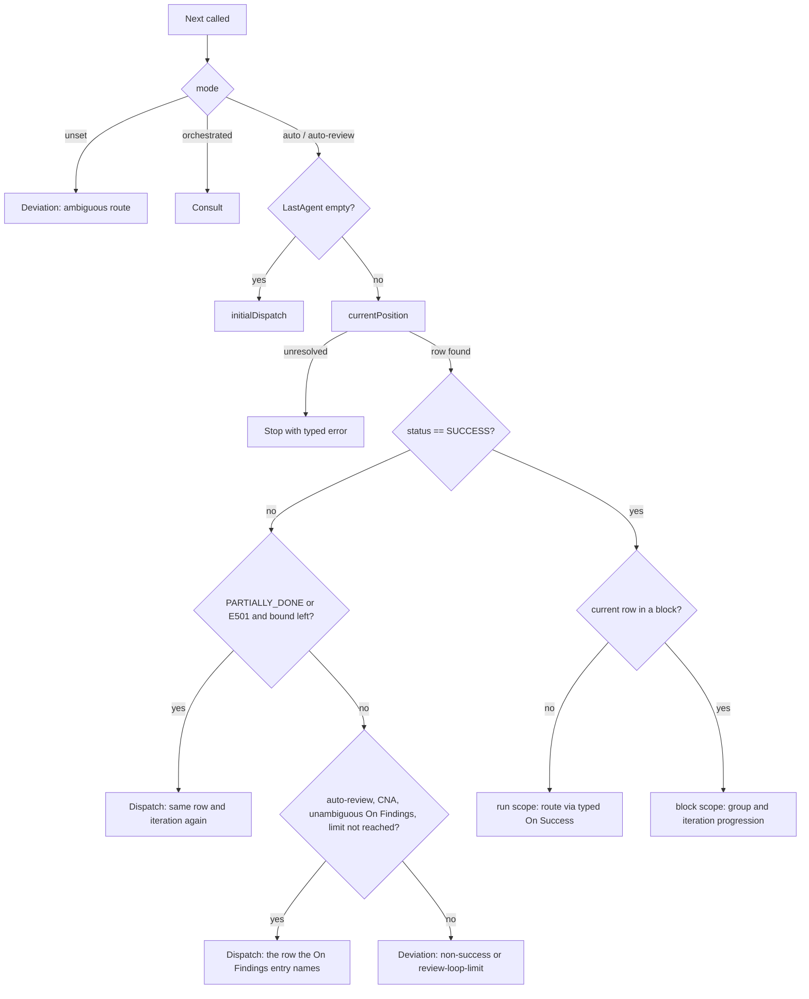

# engine

> Responsibility: The pure, side-effect-free decision core that answers "what happens next" for a run — given the admitted workflow, the block schedules, the execution mode and the current artifact state, it decides whether to dispatch an agent, mark the run complete, hand the decision to the routing consultant, escalate a deviation, or stop.

## Overview

`engine` is the state machine at the heart of the runner. Every other package either feeds it inputs (workflow, block schedules, artifact state) or acts on its outputs (session, via dispatch/harness/artifact/consultation). It contains no I/O and no non-deterministic behavior — the same inputs always produce the same `EngineDecision`, which is what makes golden-file testing of full runs possible.

The package exposes:
- **`Next(NextInput)`** — the per-invocation router: given the state after the most recent agent response (or no prior response at all), decide the next step. All inputs, including the execution mode, the last step's written output artifacts and the artifact registry, arrive in `NextInput`.
- **`ResumePointFromSchedules`** — a purely artifact-derived function used once when a run is resumed after a process restart: it reconstructs where execution left off from the Execution Log and the block schedules, independent of `Next`.
- **`ResolveRowDefaultsForIteration` / `ResolveArtifactsForIteration`** — the one routine that resolves a row's default input artifacts, output artifacts and HITL for an iteration of the row's block. The engine's own dispatch step and session's consultation-routed dispatches (and the manual routing dialogue's pre-checked lists) all use it, so a consulted dispatch defaults exactly like an engine-routed one.
- **`IterationArtifactCandidates`** (`iteration_artifacts.go`) — pure selection of the ended iteration's own artifacts for a commit-class `ITERATION_END` dispatch: the `Input` and `Output` cell entries of the block's rows that fill in the block ID, resolved to the iteration (a `*` is kept unexpanded), de-duplicated in table order. Session expands wildcards and checks existence on disk.
- **`E501BudgetRemaining`, `PartiallyDoneRedispatchLimit`, `E501AttemptLimit`, `ScheduleDefectAttempts`, `ScheduleDefectRedispatchLimit`, `IsLastRowOfIteration`, `IsLastRowOfPhaseForIteration`** — shared helpers and bounds that session also reads. The two boundary helpers take one `BoundaryInput` (workflow, schedules, completed row, iteration, log, mode).

Both `Next` and `ResumePointFromSchedules` operate on the routing table shape produced by **compat** (`AdmittedWorkflow`, with its per-block model) and the per-block schedules produced by **planstages** (`BlockSchedules`, keyed by block name).

## Components / Subdomains

| Component | Purpose |
|-----------|---------|
| **Next / mode routing** (`engine.go`, `next_input.go`, `next_branches.go`) | Selects behaviour by `NextInput.Mode`, locates the row that just ran, and classifies the situation (first call, non-SUCCESS, SUCCESS on a run-scope row, SUCCESS on a block row). |
| **Position derivation** (`position.go`) | Derives the current row and iteration from the Execution Log entry of the step that just ran. Shared by `Next` and `ResumePointFromSchedules`, so live routing and resume cannot disagree. |
| **Mechanical retry** (`retry.go`) | The bounded re-dispatch of a PARTIALLY_DONE or BLOCKED/E501 step in auto and auto-review modes. |
| **Review loop** (`next_branches.go`, `rowlookup.go`) | Auto-review route-back of a reviewer's findings and the review loop limit. |
| **Scope routing and iteration order** (`run_scope.go`, `block_scope.go`, `blocks.go`, `iterations.go`, `orderedGroupsForIteration`) | Routes by the typed `On Success` entry within the row's scope (the run, a group, or an ungrouped iteration), resolves which groups run and in what order for an iteration by looking up the iteration's `Approach` token in the block's approach rows, and picks the next iteration in schedule order whose `Depends On` iterations have completed (completion is derived from the Execution Log). |
| **Dispatch step construction** (`buildDispatchStep`, `row_defaults.go`, `artifacts.go`) | Builds the concrete `DispatchStep` (protocol request, effective HITL, resolved artifact paths, recorded phase and iteration value) for a target row. |
| **ResumePointFromSchedules** (`resume.go`, `resume_scope.go`) | Reconstructs a `ResumeInfo` purely from `ArtifactState`, skipping trailing infrastructure entries; after a clean completion the position is the one scope routing gives. |

## Key Flows

### Next — mode first

1. **`ExecutionModeUnset`** (a programming error): returns a Deviation of kind `DeviationAmbiguousRoute`; never coerces to another mode.
2. **`orchestrated`**: the engine never routes. Every call, including the first of a new run, returns a **Consult** decision (`ConsultTriggerOrchestratedMode`) carrying the current row (`-1` on the first decision), phase and iteration. Position-resolution errors are ignored here because the orchestrator reads the artifact itself.
3. **`auto` / `auto-review`**: the routing below.

Details for the auto modes:

1. **First call** (`state.CurrentState.LastAgent == ""`): `initialDispatch` enters row 1, entering the block it begins when it begins one. A block without a schedule stops, with a `*domain.MissingScheduleError` whose reason names the path its schedule was looked for (and whether it was supposed to be seeded); an empty schedule is not an error and the block exits at once.
2. **Non-SUCCESS response**, in this order: mechanical retry (below); in `auto-review` only, a COMPLETED_NEEDS_ACTION whose row has an `On Findings` target routes back, unless the review loop limit is reached; everything else returns a **Deviation** carrying the response and position. In `auto` mode COMPLETED_NEEDS_ACTION is always a deviation.
3. **SUCCESS on a run-scope row** (`routeSuccess`): routes via the row's typed `On Success` entry. A target dispatches exactly the row it names; `NEXT` dispatches the row below, entering the block it begins, and completes the run past the last row; `[Name]` enters that block; `COMPLETE` ends the run. An entry the engine cannot route (a zero kind hand-built into a table, or a fork outside Mode 1) returns a Stop with a `*domain.UnroutableEntryError`. Every dispatch a SUCCESS produces, on a run-scope or a block row, then passes the finished-work check (`finishedWorkDeviation`): a single-step dispatch whose row and iteration value already have a `SUCCESS` in the Execution Log (recorded `WorkflowRow` equal, iteration value equal; entries with no row or an unreadable iteration value never count) is replaced by a `DeviationFinishedWork` deviation whose `PlannedContinuation` is that step. The kind is internal and never serialised; on resume the response in the deviation is the zero value.
4. **SUCCESS on a block row** (`afterScopeRow`): the typed `On Success` entry is read within the row's scope: a target dispatches that row of the group (or ungrouped iteration), `NEXT` the row below when it is in the scope, `COMPLETE` ends the scope. Ending a group starts the next group the iteration's approach lists; after the last group the iteration has completed and the next iteration is chosen, or the block exits to the row below it.

### Position derivation

`currentPosition` takes the last Execution Log entry of the exact instance recorded as `LastAgent` (or an entry synthesised from `current_state`, which records no row). `resolvePosition` then applies one rule for both live routing and resume:

- An entry that records a **workflow row** (`WorkflowRow`, the 1-based Row number) is positioned at that row for every row type, validated against the table: the row exists and holds the entry's agent; for a block row the entry must also record an `Iteration` value the row accepts (`{ID}`, or `{ID}.{Group}` with the row's own group when the row is grouped).
- Only an entry that records **no row** falls back to resolving by agent and phase (bare agent id): the first row with that agent and phase for a row outside every block, the agent's single block row for a block entry.
- Nothing is ever guessed. The failures are `*domain.PositionUnresolvedError` with a cause: agent not a workflow participant, agent fills several rows of its phase and the entry records no row, recorded row invalid (outside the table, other agent, other group), or a block row whose entry records no iteration or one the row does not accept. `Next` turns it into a **Stop** decision whose `Err` carries the typed error (`Reason == Err.Error()`); `ResumePointFromSchedules` returns it wrapped.

Recorded iterations use the OAF 3.0 form (`1.Test` for a grouped row, `A` or `1` for an ungrouped one, via `domain.FormatIterationValue`; `-` outside every block); the pre-3.0 forms are no longer read: parsing reports `artifact.ErrPre30Layout` for the `Stage` column and `current_state.stage`, the row-aware read (`domain.ReadIterationValue`) refuses `{Group}.{ID}` on a grouped row and does not strip `Stage-` (so `Stage-1` is the ID `Stage-1`), and resume refuses such runs before dispatch. Recorded phases are the bare phase name (`EXECUTION`), never the table's qualified string.

### Mechanical retry (auto and auto-review)

`mechanicalRetry` re-dispatches the same row and iteration (the step is marked `Retry`) for two cases, with all counting taken from the Execution Log:

- **PARTIALLY_DONE**: with k the length of the trailing run of PARTIALLY_DONE rows at the row and iteration (rows with no recorded workflow row are skipped), re-dispatch while `k <= PartiallyDoneRedispatchLimit` (3) and deviate when k exceeds it. The re-dispatch hands over the previous output artifacts as inputs and appends the previous status message to the task description (`PartiallyDoneContextPrefix`). This bound is Runner-only; the native orchestrator policy has no cap.
- **BLOCKED with E501**: `E501BudgetRemaining` is `E501AttemptLimit` (3) minus the E501 rows at the row and iteration since the last SUCCESS there; re-dispatch while it is above zero. The error code of the last step comes from the live response, or from the recorded log entry on resume.

In orchestrated mode neither applies: every such failure is a consultation.

### Review loop (auto-review)

On COMPLETED_NEEDS_ACTION with an `On Findings` target, `findingsRouteBack` dispatches **the row the typed entry names** (resolved at parse time by whole-cell match of a `Subagent` cell, so there is no nearest-row search). A target in the block of the reviewer's row keeps the current iteration; any other target runs outside an iteration. An entry of kind none (`-`) is a Deviation. The dispatched step's inputs are the row's own, plus the reviewer's written output artifacts (`LastOutputArtifacts`), plus the target agent's own earlier outputs found in the artifact registry (matched against the step's resolved output paths), deduplicated with run-prefixed and unprefixed forms treated as equal. A SUCCESS-routed dispatch never carries injected artifacts.

`review_loop_limit` (0 = none, persisted in the artifact frontmatter) bounds this: `reviewLoopLimitReached` counts the reviewer's COMPLETED_NEEDS_ACTION rows keyed by reviewer, phase and iteration value (not by row) since that reviewer's last SUCCESS there. A COMPLETED_NEEDS_ACTION directly following the same reviewer's own COMPLETED_NEEDS_ACTION is a re-dispatch of the same round and is not counted again; a reviewer SUCCESS directly following its own COMPLETED_NEEDS_ACTION is a gate-discharging re-dispatch, not a pass, and does not reset the count. When the count reaches the limit the engine returns a Deviation of kind `DeviationReviewLoopLimit` instead of routing back.

### Block group and iteration progression (`afterScopeRow`, `router`)

1. Determine the ordered group list for the current iteration via `orderedGroupsForIteration`. For an ungrouped block the approach is ignored and the single implicit group is returned. For a grouped block the iteration's `Approach` token is looked up verbatim and case-sensitively in the block's approach rows; no match returns `*domain.UnresolvableApproachError` (no default approach, no fallback).
2. The row's own `On Success` entry decides inside the group: a target dispatches that row, `NEXT` the row below while it is in the group. A row that is in none of the ordered groups returns `*domain.RowNotInGroupError`.
3. When the entry ends the group's scope (`COMPLETE`, or `NEXT` from its last row) and another group remains in the iteration, jump to the next group's first row.
4. When the last group's scope ends, the iteration is complete; move to the next iteration in schedule order whose `Depends On` iterations have completed (group order re-derived from that iteration's approach). Completion is derived from the Execution Log alone, so a re-entered block runs only its uncompleted iterations.
5. If no runnable iteration remains, the block exits: the row below the block is dispatched (entering the block it begins), or the run completes when the block ends the table.

### ResumePointFromSchedules — reconstructing position after a restart

Called once at run start, before the dispatch loop:

- It looks at the last **workflow** entry of the log, skipping trailing infrastructure entries (agents absent from the routing table and present in the `InfraAgentSet`). An entry that is neither a workflow participant nor infrastructure is a `PositionUnresolvedError`. No workflow entry at all means a fresh start from row 0.
- **Last workflow entry matches `CurrentState.LastAgent`**: clean completion; resume from the position scope routing gives for the completed row's declared `On Success` over the iterations the log shows completed (`resumeAfterScopedRow`) — the same position `Next` dispatches at in `auto` and `auto-review`. A block with no schedule yet resumes at the block's first row and `Next` then stops with the missing-schedule reason.
- **Last workflow entry does NOT match**: the process died mid-invocation; `ResumeInfo.RerunLast` is set and the same row is re-dispatched.
- Position resolution uses the same recorded-row rule as `Next`; an entry whose row cannot be identified is an error, never a guess.

### Dispatch step construction

`buildDispatchStep` assembles the `DispatchStep` for a row:
- **Effective HITL** = row-level HITL OR (for a block row) that iteration's HITL flag from the block's schedule.
- **Artifact paths** (`ResolveArtifactsForIteration`): the fill-in `{Name}` of the row's block (for example `{Stage}` for block `Stage`) is replaced with the iteration ID verbatim in Input and Output entries (an iteration is required, otherwise an unresolvable-template error becomes a `Stop`). An entry containing `*` is passed through unchanged; the session expands Input wildcards against the run folder and passes Output wildcards literally.
- **Agent instance ID** is `{bareAgentID}#{seq+1}`; a row with a mode qualifier is dispatched under its bare agent id and its task description gains a focus paragraph (`QualifierFocusPrefix`).
- The step records `Phase` (bare name) and the iteration value (`Stage` field of the step, written to the log's `Iteration` column) for the artifact.

## Relationships

| Talks To | For |
|----------|-----|
| **domain** | Sole internal import — all types (`AdmittedWorkflow`, `BlockSchedules`, `ArtifactState`, `ProtocolResponse`, `EngineDecision` and its variants, `ResumeInfo`, `WorkflowRow`) come from here. `engine` imports nothing else internal and no I/O packages. |
| **session** | The exclusive consumer. Session calls `ResumePointFromSchedules` once at run-start, then `Next` in a loop, translating each `EngineDecision` into I/O. It also calls `ResolveRowDefaultsForIteration`, `E501BudgetRemaining`, `ScheduleDefectAttempts`, `IterationArtifactCandidates` and the boundary helpers. |
| **compat** (indirect, via inputs) | Supplies the `AdmittedWorkflow` shape (`Blocks` with row ranges, `Groups`, `Approaches`, seed classification). |
| **planstages** (indirect, via inputs) | Supplies each block's `BlockSchedule` (iteration IDs, `Approach`, `HITL` and `Depends On` per iteration). |

## Key Concepts

| Concept | Meaning |
|---------|---------|
| **EngineDecision** | Exactly one of `Dispatch`, `Complete`, `Deviation`, `Consult`, `Stop` is non-nil. |
| **Consult vs. Deviation** | Both end in the same session routine and a consultation request. A Deviation means the engine tried and could not decide; a Consult means it was never entitled to decide (orchestrated mode). |
| **Typed routing entries** | The parser resolves every `On Success` (target, `[Name]` block entry, fork, `NEXT`, `COMPLETE`) and `On Findings` (target or none) cell to a typed entry with a row index, so the engine never interprets cell text. |
| **Scopes** | A row routes within its scope: the run, a group of one iteration, or an ungrouped iteration. A target never leaves the scope; ending a scope moves to the next group, the next iteration, or the block's exit (WorkflowFormat 2.16 sec. 6.5). |
| **Deviation kinds** | `DeviationNonSuccess` (non-SUCCESS without a usable retry or route-back), `DeviationAmbiguousRoute` (unroutable entry or unset mode), `DeviationReviewLoopLimit` (auto-review limit reached), `DeviationHarnessError` (declared in domain, never produced inside `engine`; session raises it when a consultation-routed HITL re-dispatch hits a harness error), `DeviationFinishedWork` (an engine-routed SUCCESS whose next step already finished; the manual resolver pre-selects `PlannedContinuation`). |
| **Interruption / RerunLast** | Detected by `ResumePointFromSchedules` when the last workflow log entry's agent differs from `CurrentState.LastAgent`; the interrupted row is re-dispatched rather than advanced past. |

## Boundaries

- **Owns:** the routing decision logic — what row runs next, in what order, with what effective HITL and resolved artifact paths; the mechanical retry bounds; the review loop limit; position derivation from the log; resume-position reconstruction.
- **Does Not Own:** parsing or validating the workflow/schedule/artifact inputs; performing dispatch, I/O or clock reads (session and its adapters); resolving a Consult or Deviation (session and `deviation`); anti-loop protection of consultant-requested dispatches (session); constructing `AgentReference` values (agentresolve).

## Invariants & Conventions

- No I/O, no filesystem/network/random access, no `time.Now()` anywhere in this package — the `time.Time` in `NextInput` is accepted but not inspected by any routing logic.
- Exactly one field of `EngineDecision` is non-nil per call. `DispatchDecision.Steps` always holds exactly one element.
- A row's `On Success` is routed within its own scope in `auto` and `auto-review`; `On Findings` is only consulted for COMPLETED_NEEDS_ACTION in `auto-review`.
- Row and iteration always come from the recorded `WorkflowRow` when the log entry has one; a mismatch between the entry and the table is an error, not a fallback.
- Mechanical retries are counted from the Execution Log, never from in-memory state, so they hold across a restart.

## Known Complexity

The position derivation (`position.go`) and the review loop counting (`reviewLoopLimitReached`) are the most intricate parts; both are described above and covered by dedicated test files in the package. No deeper-tier document is recommended.
